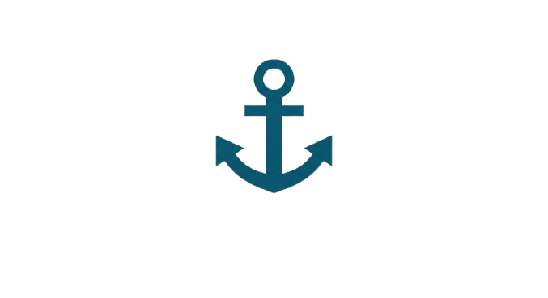
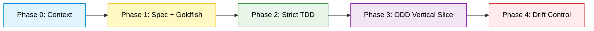

<div align="center">
  
  <br><br>
  <h1>⚓ Keel Nav</h1>
  <p><strong>The structural keel for AI-assisted engineering.</strong><br>
  <em>Without it, you drift.</em></p>

  <p>
    <a href="https://github.com/MrErov/keel-nav/releases"></a>
    <a href="https://github.com/MrErov/keel-nav/blob/main/LICENSE"></a>
    <a href="https://github.com/MrErov/keel-nav"></a>
    <a href="https://github.com/MrErov/keel-nav"></a>
  </p>
</div>

---

## 📖 Table of Contents
- [🧠 The Problem](#-the-problem)
- [🛠️ The Solution: 5 Phases](#%EF%B8%8F-the-solution-5-phases)
- [🏭 Proven in Production](#-proven-in-production)
- [🚀 Quick Start](#-quick-start)
- [🔌 Harness Compatibility](#-harness-compatibility)
- [📚 Meta-skill Reference](#-meta-skill-reference)
- [⚖️ How Keel Nav Compares](#%EF%B8%8F-how-keel-nav-compares)
- [💰 Token Economics](#-token-economics)
- [🤝 Contributing](#-contributing)
- [📄 License](#-license)

---

## 🧠 The Problem

AI-assisted engineering has split into two unsustainable extremes:

1. **Vibe coding** — loose prompts, no spec, no tests. Silent technical debt compounds until the project capsizes.
2. **Mega-frameworks of autonomous sub-agents** — orchestrators that burn tokens, degrade context ("context rot"), and produce over-engineered code that nobody can audit.

Both fail at the same point: **the human stops being the Navigator** and becomes a spectator to an opaque, expensive process.

---

## 🛠️ The Solution: 5 Phases

Five phases. Each phase is a single meta-skill in pure Markdown. **Human commands, AI executes within bounds.**

| Phase | Name | Goal | Meta-skill |
|-------|------|------|------------|
| 0 | **Context Bootstrap** | Map the repo before planning (Elephant Memory) | `00-context-bootstrap.md` |
| 1 | **Lightweight SDD + Goldfish Audit** | Specs per User Story + blind anti-bias audit | `01-sdd-spec-writer.md`, `02-egm-goldfish-audit.md` |
| 2 | **Strict TDD** | Red → Green → Refactor with minimal code | `03-tdd-cycle.md` |
| 3 | **ODD & Vertical Slices** | DB → API → UI, one slice at a time | `04-odd-vertical-slice.md` |
| 4 | **Drift Control** | Final audit against the original spec | `05-drift-control.md` |



---

## 🏭 Proven in Production

> 🏆 **Battle-tested on a real Odoo + LangGraph codebase.**  
> Keel Nav recently caught a *fail-open security vulnerability* in a production repository, enforced a logical audit (Goldfish), and implemented the fix with **699 green tests and zero regressions**.  
> [Read the Case Study](./docs/case-studies/001-contafis-assistant.md)

---

## 🏷️ The Metaphor (and the Method)

Three roles, one discipline:

| Role | Who | What they do |
|------|-----|--------------|
| **Navigator** | You, the human | Sets the course: user stories, specs, acceptance criteria, phase transitions. |
| **Helmsman** | The AI agent | Executes within protocol: writes specs, tests, code — never beyond the gate. |
| **Keel** | This repo | The structural spine that keeps the ship upright when the sea gets rough. |

`Keel Nav` is the keel. It gives the Helmsman a protocol and the Navigator a rudder. Without it, autonomous agents drift into vibe coding, context rot, and token burn.

---

## ⚓ Principles

1. **Human = Navigator.** The AI never decides *what*; only *how*, within bounds.
2. **Truly agnostic.** Pure Markdown. No SDK, no proprietary YAML, no lock-in.
3. **Token economy as a design constraint.** Every meta-skill declares its estimated cost.
4. **Blind audits (Goldfish).** Context-isolated sub-agents with no chat memory, eliminating self-confirmation bias.
5. **TDD as a scope contract.** No test, no feature. No red, no green.
6. **Anti-over-engineering.** The AI writes the *minimum* code to pass.
7. **Spec ↔ code traceability.** The Drift Check certifies both match.
8. **Context rot prevention.** Per-directory context docs, regenerable and versioned.

---

## 🤖 For AI Agents

If you are an AI agent reading this README before acting inside this repo:

1. **Stop.** Read [`AGENTS.md`](./AGENTS.md) first. It is the canonical behavioral contract. It overrides any harness-specific file (`CLAUDE.md`, `.cursorrules`, `harnesses/*`).
2. **Do not vibe-code.** `AGENTS.md` §5 enumerates what counts as a blocking violation. The short version: no spec → no code.
3. **Respect phase boundaries.** `AGENTS.md` §4 and §6. You write only the outputs declared by the current phase's meta-skill.
4. **Respect token budgets.** `AGENTS.md` §7. If you exceed 150% of a skill's declared budget, stop and report.
5. **If a rule is ambiguous, escalate.** `AGENTS.md` §9 has the format.

This section is a doorway, not a copy. The authoritative text lives in `AGENTS.md`, and it is the only file that may be edited to change agent behavior.

---

## 📁 Repository Structure

```
keel-nav/
├── .meta-skills/                    # Agnostic core (pure Markdown)
│   ├── 00-context-bootstrap.md      ✅ v0.1.0-alpha
│   ├── 01-sdd-spec-writer.md        ✅ v0.1.0-alpha
│   ├── 02-egm-goldfish-audit.md     ✅ v0.1.0-alpha
│   ├── 03-tdd-cycle.md              ✅ v0.1.0-alpha
│   ├── 04-odd-vertical-slice.md     ✅ v0.1.0-alpha
│   └── 05-drift-control.md          ✅ v0.1.0-alpha
├── templates/                       # Artifacts produced by the skills
│   ├── spec.template.md             ✅ v0.1.0-alpha
│   ├── test-plan.template.md        ✅ v0.1.0-alpha
│   └── drift-report.template.md     ✅ v0.1.0-alpha
├── harnesses/                       # Per-tool adapters (thin entry points)
│   ├── opencode/                    ✅ v0.2.0-alpha
│   ├── claude-code/                 ✅ v0.2.0-alpha
│   ├── cursor/                      ✅ v0.2.0-alpha
│   ├── generic/                     ✅ v0.1.0-alpha
│   └── dsh-bridges/                 ✅ v0.2.0-alpha  (documentation only)
├── docs/                            # Methodology documentation
│   ├── context/                     # Phase 0 self-applied (Elephant Memory)
│   │   └── 00-overview.md           ✅ Phase 0 baseline
│   ├── designs/                     ✅ post-v0.2.0-alpha
│   │   ├── effective-verdict.md
│   │   ├── blind-audit-protocol.md
│   │   └── skill-compression.md
│   ├── case-studies/                ✅ v0.4.0-beta
│   │   └── 001-contafis-assistant.md
│   └── known-limitations.md         ✅ post-v0.2.0-alpha
├── examples/                        # Educational artifacts
│   └── todo-api/                    ✅ post-v0.2.0-alpha (constructed walkthrough)
├── AGENTS.md                        ✅ Canonical AI behavioral contract
├── CONTRIBUTING.md                  ✅ Contribution protocol
├── CHANGELOG.md                     ✅ v0.4.0-beta
├── LICENSE                          ✅ MIT
├── .gitignore                       ✅
└── README.md                        ✅
```

> **Legend:** ✅ = shipped. The version in parentheses is the release where the file landed. Items marked `post-v0.2.0-alpha` are on `main` but not in a tagged release.

---

## 🚀 Quick Start

```bash
# 1. Clone
git clone https://github.com/<org>/keel-nav.git
cd keel-nav

# 2. Pick a harness and follow its README.
#    Example: OpenCode
mkdir -p /path/to/your-project/.opencode/skills
cp -r harnesses/opencode/skills/* /path/to/your-project/.opencode/skills/
cp -r .meta-skills /path/to/your-project/

# 3. In your editor/CLI, invoke Phase 0 on your target repo:
#    /context-bootstrap
```

No installer. No `npm i`. Just text your LLM can read.

---

## 🔌 Harness Compatibility

| Harness | Mechanism | Location |
|---------|-----------|----------|
| OpenCode | Native skills | `harnesses/opencode/skills/` |
| Claude Code | `CLAUDE.md` + directives | `harnesses/claude-code/CLAUDE.md` |
| Cursor | `.cursorrules` | `harnesses/cursor/.cursorrules` |
| Copilot CLI / Gemini CLI / Web LLMs | Pasted prompt | `harnesses/generic/prompts/*.md` |
| **DeepSeek Harness** | Via [`dsh-bridges`](https://github.com/deepseek-ai/dsh-bridges) (auto-detects the adapters above) | No install; `dsh-bridges` reads OpenCode / Claude Code / Cursor layouts |

Each harness is a **thin entry point** that points at `.meta-skills/`, not a fork. Two shapes: per-phase shims (≤50 lines each, e.g. OpenCode) and persistent directive files (≤250 lines total, e.g. Claude Code, Cursor). Neither embeds the protocol.

> **Why DeepSeek appears as a bridge and not a directory:** `dsh-bridges` is a community plugin that reads existing Claude Code / OpenCode / Cursor adapter layouts. Keel Nav doesn't need a `harnesses/deepseek/` directory — the other adapters are shipped, and `dsh-bridges` picks them up. See [`harnesses/dsh-bridges/`](harnesses/dsh-bridges/) for the integration notes. That is Keel Nav's agnosticism working as intended.

---

## 📚 Meta-skill Reference

| Skill | Phase | Input | Output | Tokens (est.) |
|-------|-------|-------|--------|---------------|
| `00-context-bootstrap` | 0 | Repo root | `docs/context/*.md` | 3k–8k |
| `01-sdd-spec-writer` | 1 | User Story | `specs/<US>.spec.md` | 2k–4k |
| `02-egm-goldfish-audit` | 1 | Spec | `specs/<US>.audit.md` | 1k–2k |
| `03-tdd-cycle` | 2 | Approved spec | Tests + code | 2k–6k |
| `04-odd-vertical-slice` | 3 | Spec + tests | DB → API → UI | 4k–10k |
| `05-drift-control` | 4 | Spec + code | `drift-report.md` | 2k–3k |

---

## ⚖️ How Keel Nav Compares

| Project | What we take | What we avoid |
|---------|--------------|---------------|
| `github/spec-kit` | Plain-Markdown specs | Flow coupled to GitHub |
| `google/elephant-goldfish-model` | Blind sub-agent + Drift Report | Heavy framework |
| `Fission-AI/OpenSpec` | Context-rot prevention | Proprietary DSL |
| `open-gsd/gsd-core` | Phase structure | Runtime dependency |
| **Keel Nav** | Strict TDD + ODD vertical slices | — |

---

## 💰 Token Economics

Our thesis: token spend is a symptom of design, not of scale.

- Goldfish Audit runs in a memoryless sub-agent → pays ~1k tokens, not ~15k.
- Strict TDD forces the model to write the minimum → fewer iterations, fewer refactors.
- Per-directory context avoids resending the full tree every turn.
- Drift Check catches deviations early → avoids costly rewrites.

---

## 🤝 Contributing

Keel Nav is small by design, and contributions are judged by **clarity, cost control, and harness agnosticism** — not by lines of code. The full protocol lives in [`CONTRIBUTING.md`](./CONTRIBUTING.md).

Quick summary:

- **Meta-skill changes** require an issue labeled `accepted-for-pr` before a PR opens. Unstable meta-skills are worse than no meta-skills.
- **Harness adapters** are thin entry points that point to `AGENTS.md` and `.meta-skills/` — never forks. Two shapes: per-phase shims (≤50 lines each) and persistent directive files (≤250 lines total). Neither embeds the protocol.
- **No external dependencies** inside `.meta-skills/`. Pure Markdown only.
- **Every PR** declares its token impact (`before`, `after`, `delta`, justification).

---

## 📄 License

MIT — because methodological knowledge should not have lock-in.